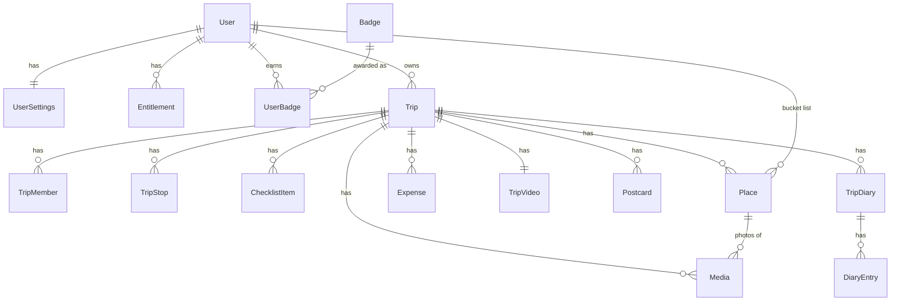

# Travel App data model

Version 0.3, 10 Nov 2026. This file is the source of truth for the data model. It replaces section 8 of the handoff document.

Labels:
- **AGREED**: confirmed by the owner. Do not change without a new decision.
- **PROPOSED**: written by Claude, waiting for the owner. Each one has a recommendation.
- **OPEN**: a choice is needed. See "Decisions needed" below.

---

## Decisions

Answered by the owner on 10 Nov 2026. Items marked OPEN are postponed and will be decided later.

| # | Question | Decision | Status |
| --- | --- | --- | --- |
| D1 | Place: one entity for bucket list, planned and visited? | Yes. One record follows a place from bucket list to planned to visited. A repeat visit on a new trip gets a new record | AGREED |
| D2 | Removed member: what happens to their pins and photos? | Others keep the originals. The removed person gets personal copies | AGREED |
| D3 | Who owns a photo in a shared trip? | The person who added it. A shared photo is visible to every member. If anyone deletes it, it is hidden only for that person; the others keep it | AGREED |
| D4 | When can others see a shared photo? | The record syncs first; others see a grey placeholder until the file is uploaded | AGREED |
| D5 | Expense currency | The user picks the currency for each expense. Default is the local currency of the current stop (Morocco gives MAD). Each person sees the amount converted to their own home currency | AGREED |
| D6 | Expense splitting | To be defined in detail later | OPEN |
| D7 | Personal expenses in a shared trip (only you see them)? | Yes | AGREED |
| D8 | Who fills in the exchange rate when the expense was added offline? | Resolved by D5: rates come from a daily rate table, so the expense date fixes the rate (see Expense) | AGREED |
| D9 | Postcards | One per country per trip | AGREED |
| D10 | Diary contents | One entry per day plus a trip summary, editable. The look (an HTML-style template) is still to be designed | AGREED (template OPEN) |
| D11 | Diary in a shared trip: one per member or one for the group? | Not answered yet. Recommendation: one per member | OPEN |
| D12 | Who awards badges? | The server, during sync | AGREED |
| D13 | Does joining someone's shared trip use up your free trip? | Yes. Creating a trip or joining one both use the free trip | AGREED |
| D14 | Does a deleted trip still count toward the free limit? | Yes, after 24 hours | AGREED |
| D15 | Paid features while offline | Trust the cached plan until its expiry date | AGREED |
| D16 | Videos from the photo library | Yes, but in a later release (needs server-side processing). V1 is photos only. The data model already allows videos | AGREED |

---

## 1. Rules for every entity (AGREED)

- IDs are created on the phone (UUID v7). Exception: `User.id` is created by the server.
- Sync fields on every synced record: `createdAt`, `updatedAt`, `deletedAt` (soft delete), `version`.
- Sync pushes changed records from the outbox and pulls everything changed since the last cursor.
- Conflicts are resolved per field, last change wins.
- Derived data is not stored: visited countries, lifetime stats, the globe and the library screen are computed.

New rules (PROPOSED):
- Money is stored in minor units as whole numbers (`1250` = 12.50 EUR, `1500` = 1500 JPY). This avoids rounding errors. The number of decimals comes from the Currency table.
- Fields marked **local** live only on the phone and are never synced.
- Fields marked **server** can only be set by the server. The phone sends them back unchanged or not at all.
- Files (photos, videos, postcards) are stored in Azure Blob Storage. Records hold a `key`, never a full URL. The app asks the server for a short-lived URL when it needs the file.

## 2. Overview

---

## 3. User (AGREED)

| Field | Type | Required | Notes |
| --- | --- | --- | --- |
| `id` | UUID | yes | server |
| `email` | string | yes | Unique. server |
| `emailVerified` | boolean | yes | server |
| `authProviders` | list of enum: google, apple, email | yes | server. One account can have several login methods (L3) |
| `passwordHash` | string | no | server only, never sent to the phone. Set for email login (ASP.NET Core Identity hashing). Empty for Google/Apple-only accounts |
| `firstName` | string | yes | Max 60 |
| `lastName` | string | no | Asked only when needed (album order or payment) |
| `displayName` | string | no | Defaults to first name |
| `avatarMediaId` | UUID | no | |
| `passportCountry` | ISO 3166-1 alpha-2 | yes | Issuing country |
| `residenceCountry` | ISO 3166-1 alpha-2 | yes | |
| `homeCurrency` | ISO 4217 | yes | Defaults from residence |
| `language` | string | yes | `en` |
| `timeZone` | IANA | yes | For reminders |
| `ageConfirmedAt` | timestamp | yes | "I am 16 or older". No age or birth date stored. server |
| `termsVersion`, `termsAcceptedAt` | string, timestamp | yes | server |
| `privacyVersion`, `privacyAcceptedAt` | string, timestamp | yes | server |
| `marketingConsent`, `marketingConsentAt` | boolean, timestamp | no | Off by default |
| `onboardingCompletedAt` | timestamp | no | |
| `status` | enum: active, deletion_requested | yes | server |
| sync fields | | yes | |

## 4. UserSettings (AGREED, synced, one per account)

| Field | Default |
| --- | --- |
| `remindersEnabled` | true |
| `remindChecklist` | true |
| `remindPackTonight` | true |
| `remindFlight` | true |
| `remindAnniversary` | true |
| `reminderTime` | 19:00 local |
| `quietHoursStart`, `quietHoursEnd` | 22:00, 08:00 |
| `distanceUnit` | km (or mi) |
| `temperatureUnit` | C (or F) |
| `defaultPlaceScope` | shared (or personal) |

## 5. DeviceSettings (AGREED, local only)

`uploadOnWifiOnly` (true), `biometricUnlock` (false; Face ID / fingerprint to open the app), `introSeen` (false), `deviceId` (random, created on first open, kept in secure storage), `theme` (system, light, night), `autoCaptureEnabled` (false), `autoCaptureCursor`, `pushPermission`, `analyticsConsent`, `lastSyncCursor`, `lastSyncAt`.

## 5b. Login records (AGREED 11 Nov 2026, server only, never synced)

Login uses ASP.NET Core Identity with `User` as the Identity user (its own login and code tables, snake_case). Plus:

**TrustedDevice**: `id`, `userId`, `deviceId`, `name` (e.g. "Pixel 8"), `trustedAt`, `lastSeenAt`, `expiresAt` (1 year after `lastSeenAt`). Email logins on a trusted phone need no code.

**RefreshToken**: `id`, `userId`, `deviceId`, `tokenHash`, `createdAt`, `expiresAt` (1 year since last use), `replacedByTokenId`, `revokedAt`. Replaced on every use; reuse of an old one revokes all of the user's tokens.

**AuthCode** (AGREED 11 Nov 2026 with KAN-12, server only, not synced): `id`, `email` (normalised), `purpose` (signup, login, reset), `codeHash`, `createdAt`, `expiresAt` (10 minutes), `attempts` (max 5), `consumedAt`, and for sign-up only `pendingPasswordHash` and `pendingMarketingConsent`. Why: Identity's built-in codes cannot enforce A5 (10 minutes, 5 tries, 1 per minute, 5 per hour), and the email account is created only after the code is entered, so the pending sign-up needs a place to wait.

Note (AGREED 11 Nov 2026, KAN-12): `firstName`, `passportCountry`, `residenceCountry` and `homeCurrency` are empty in the database between sign-up and profile setup; the consent fields are empty for Google/Apple users until profile setup. The app treats `onboardingCompletedAt` as "profile done".

## 6. AppConfig (AGREED, read-only, set in the back office, cached for offline)

`photoQualityByPlan`, `maxPhotoSizeMB`, `minAppVersion`, feature flags (for example `printAlbumEnabled`), `freeTripLimit`.

PROPOSED additions: `staticDataVersion` and `staticDataUrl` (to update countries and currencies without an app release).

## 7. Trip (AGREED)

| Field | Type | Required | Notes |
| --- | --- | --- | --- |
| `id` | UUID | yes | |
| `ownerId` | UUID | yes | |
| `name` | string | yes | Defaults from the stops |
| `type` | enum: solo, shared | yes | Can switch from solo to shared |
| `startDate`, `endDate` | date | no | Empty when unknown (countdown and reminders stay off) |
| `activities` | list of enums | no | Beach, City, Culture, Food, Hiking, Skiing, Road trip, Business, Relaxing |
| `status` | enum: planned, finished | yes | Active is derived from the dates |
| `finishedAt` | timestamp | no | Set by "Finish trip" |
| `coverMediaId` | UUID | no | |
| `passportCountrySnapshot` | ISO country | yes | Copied from the user at creation |
| `homeCurrencySnapshot` | ISO currency | yes | The owner's home currency at creation. Not used for expense conversion; each person sees their own home currency (D5) |
| `checklistGeneratedAt`, `checklistRulesVersion` | timestamp, string | no | |
| `anniversaryEnabled` | boolean | yes | Default true |
| sync fields | | yes | |

Finishing a trip: the app asks "How was <trip>?" the day after the end date. The user can finish it earlier by hand.

Flights moved to their own table, **Flight** (section 8b, agreed 11 Nov 2026). `flightOutAt` and `flightBackAt` are removed from Trip.

## 8. TripStop (AGREED)

`id`, `tripId`, `order`, `countryCode`, `cityName`, `lat`, `lng`, `geoProviderId`, `nights`, sync fields. `lat` and `lng` are empty when the city was typed offline, and filled in when the phone is online (Create a trip). Arrival and departure dates are calculated from the trip start date and the nights in order.

A stop is a **city where the user sleeps** (agreed 11 Nov 2026, T7). Sights inside a city (the Colosseum, Fontana di Trevi) are **Places**, not stops. No maximum number of stops.

## 8b. Flight (AGREED 11 Nov 2026, T5)

A trip has a list of flights, so connections work (Tirana → Vienna → Rome). Every field except the ids and `direction` is optional.

| Field | Type | Required | Notes |
| --- | --- | --- | --- |
| `id`, `tripId` | UUID | yes | |
| `order` | int | yes | Order in the list |
| `direction` | enum: outbound, return, other | yes | Outbound and return drive the flight reminder; "other" is a flight in the middle of the trip |
| `airline` | string | no | Max 60, e.g. "Wizz Air" |
| `flightNumber` | string | no | Max 10, e.g. "W6 4567". Later used for live flight status |
| `departureAirport`, `arrivalAirport` | string | no | IATA code ("TIA") or a name, max 60 |
| `departureLocalTime`, `arrivalLocalTime` | local date-time | no | "2027-04-12T09:40", local time at that airport, no offset |
| `departureTimeZone`, `arrivalTimeZone` | IANA zone | no | E.g. "Europe/Tirane". Filled from the phone's zone for outbound and from the last stop for return; later from the airport. Needed so the reminder fires at the right moment |
| `bookingCode` | string | no | Max 12 (PNR) |
| `seat`, `terminal` | string | no | Max 10 each |
| sync fields | | yes | |

A stop is a **city where the user sleeps** (agreed 11 Nov 2026, T7). Sights inside a city (the Colosseum, Fontana di Trevi) are **Places**, not stops. No maximum number of stops.

## 8b. Flight (AGREED 11 Nov 2026, T5)

A trip has a list of flights, so connections work (Tirana → Vienna → Rome). Every field except the ids and `direction` is optional.

| Field | Type | Required | Notes |
| --- | --- | --- | --- |
| `id`, `tripId` | UUID | yes | |
| `order` | int | yes | Order in the list |
| `direction` | enum: outbound, return, other | yes | Outbound and return drive the flight reminder; "other" is a flight in the middle of the trip |
| `airline` | string | no | Max 60, e.g. "Wizz Air" |
| `flightNumber` | string | no | Max 10, e.g. "W6 4567". Later used for live flight status |
| `departureAirport`, `arrivalAirport` | string | no | IATA code ("TIA") or a name, max 60 |
| `departureLocalTime`, `arrivalLocalTime` | local date-time | no | "2027-04-12T09:40", local time at that airport, no offset |
| `departureTimeZone`, `arrivalTimeZone` | IANA zone | no | E.g. "Europe/Tirane". Filled from the phone's zone for outbound and from the last stop for return; later from the airport. Needed so the reminder fires at the right moment |
| `bookingCode` | string | no | Max 12 (PNR) |
| `seat`, `terminal` | string | no | Max 10 each |
| sync fields | | yes | |

## 9. TripMember (AGREED)

`id`, `tripId`, `userId` (empty until the invite is accepted), `inviteToken` (server), `role` (owner, member), `status` (invited, active, left, removed), `invitedAt`, `joinedAt`, `removedAt`, sync fields. Only the owner invites or removes. V1 travelers exist only as accounts.

## 10. ChecklistItem (AGREED)

| Field | Type | Notes |
| --- | --- | --- |
| `id`, `tripId` | UUID | |
| `type` | enum: task, packing | |
| `title`, `notes` | string | |
| `category` | enum | Tasks: documents, money, health, phone, transport, stay, other. Packing: clothes, toiletries, tech, documents, other |
| `done` | boolean | Done or packed |
| `doneAt`, `doneByUserId` | timestamp, UUID | |
| `dueDate` | date | Auto items derive it from a rule |
| `quantity` | number | Packing only |
| `reason` | enum: rule, weather, activity, user | |
| `source` | enum: auto, user | |
| `ruleId` | string | Stops the same auto item coming back |
| `sourceUrl`, `sourceCheckedAt` | string, date | Entry-rule items, with the "verify with official sources" disclaimer |
| `ownerUserId` | UUID | Only for personal packing items |
| `sortOrder` | number | |
| sync fields | | |

Rules: in shared trips, tasks are shared and packing items are personal. When dates, stops or activities change: new items are added; auto items no longer relevant and not done are removed with undo; items the user added, edited or ticked are never removed; a deleted auto item stays deleted.

---

## 11. Place (AGREED: D1, D2)

Pins, planned places and bucket-list items in one entity.

| Field | Type | Required | Notes |
| --- | --- | --- | --- |
| `id` | UUID | yes | |
| `tripId` | UUID | no | Empty only for bucket-list items |
| `createdByUserId` | UUID | yes | |
| `ownerUserId` | UUID | no | Set only when `scope` is personal |
| `scope` | enum: shared, personal | yes | Bucket-list items are always personal. Default from `UserSettings.defaultPlaceScope` |
| `status` | enum: bucket, planned, visited | yes | Pin shape: bucket dotted, planned outlined, visited filled |
| `title` | string | yes | Max 120 |
| `note` | string | no | The user's own text |
| `lat`, `lng` | number | no | Changed 12 Nov 2026 (Places, owner agreed): may be empty. A new place takes the position of the city of that trip day; empty when that stop has none (typed offline). The exact spot comes with the Map |
| `countryCode` | ISO country | yes | Used for the globe and passport stamps. From the stop of that day |
| `cityName`, `address`, `geoProviderId` | string | no | |
| `category` | enum: food, sight, stay, transport, other | yes | Default other |
| `plannedDate` | date | no | |
| `visitedAt` | datetime | no | Set when marked visited |
| `source` | enum: manual, autocapture | yes | |
| `isSuggested` | boolean | yes | True while auto-capture waits for the user. Suggested places are never shared |
| `coverMediaId` | UUID | no | |
| `copiedFromPlaceId` | UUID | no | Set on personal copies made when a member is removed (D2) |
| sync fields | | yes | |

Rules:
- One record goes through its life: bucket, then planned (when added to a trip, `tripId` is set), then visited.
- Marking visited is manual in V1. Auto-capture only suggests.
- Adding a bucket item to a shared trip sets `scope` to the user's default.
- A visited place cannot go back to bucket. It can go back to planned.
- Repeat visit: adding a place that already belongs to another trip creates a new record for the new trip. The old one is not changed.

## 12. Media (AGREED: D3, D4, D16)

Photos (V1) and videos (later release, D16). Also used for avatars.

| Field | Type | Required | Notes |
| --- | --- | --- | --- |
| `id` | UUID | yes | |
| `ownerUserId` | UUID | yes | The person who added it (D3) |
| `tripId` | UUID | no | Empty for an avatar |
| `placeId` | UUID | no | A photo belongs to at most one place |
| `mediaType` | enum: photo, video | yes | Only photo in V1 (D16) |
| `purpose` | enum: trip_photo, avatar | yes | |
| `scope` | enum: shared, personal | yes | Same meaning as Place |
| `source` | enum: camera, library, autocapture | yes | |
| `isSuggested` | boolean | yes | True while auto-capture waits for the user |
| `caption` | string | no | |
| `takenAt` | datetime | no | From the photo, with its time zone offset |
| `lat`, `lng`, `countryCode` | number, string | no | From the photo |
| `width`, `height` | number | yes | |
| `mimeType` | string | yes | image/jpeg or image/heic (video types later) |
| `durationSec` | number | no | Videos only |
| `contentHash` | string | yes | Stops the same photo being added twice |
| `qualityTier` | enum: compressed, full | yes | Decided by AppConfig and the plan when uploaded |
| `fileKey`, `thumbnailKey` | string | no | server. Empty until uploaded |
| `sizeBytes` | number | no | server |
| `uploadedAt` | timestamp | no | server. Empty means "not uploaded yet" (placeholder for others, D4) |
| `includeInVideo` | boolean | yes | Default true |
| `sortOrder` | number | no | |
| sync fields | | yes | |

Local only (table `MediaLocal`, one row per Media on this phone): `mediaId`, `localUri`, `deviceAssetId` (photo library id), `uploadStatus` (pending, uploading, uploaded, failed), `uploadAttempts`, `lastError`.

Upload flow:
1. The phone saves the photo and the Media record locally.
2. The record syncs like any other record.
3. A background job asks the server for an upload URL, uploads the file (Wi-Fi only by default), then tells the server it is done. The server sets `fileKey`, `thumbnailKey`, `sizeBytes`, `uploadedAt`.
4. A new phone downloads thumbnails first and full files when they are opened.

Notes:
- If a free user later upgrades, photos already uploaded stay compressed unless the original is still on the phone. The app can offer "upload originals" for those.
- Deleting a **personal** photo: soft delete, file removed from storage after 30 days.
- Deleting a **shared** photo (D3): it is hidden only for the person who deletes it, whoever they are (the person who added it or another member). The record and file stay for the others. Stored as a `MediaHidden` row.
- The file is removed from storage only when no member can see it any more.

**MediaHidden** (synced): `id`, `mediaId`, `userId`, `hiddenAt`, sync fields. Unique per `mediaId` and `userId`. Each person only syncs their own rows.

## 13. Expense (AGREED: D5, D7, D8. Splitting OPEN: D6)

| Field | Type | Required | Notes |
| --- | --- | --- | --- |
| `id` | UUID | yes | |
| `tripId` | UUID | yes | |
| `createdByUserId` | UUID | yes | |
| `paidByUserId` | UUID | yes | Defaults to the creator |
| `scope` | enum: shared, personal | yes | Personal expenses are seen only by `ownerUserId` (D7) |
| `ownerUserId` | UUID | no | Set only when personal |
| `title` | string | yes | Max 80 |
| `category` | enum: food, transport, stay, activities, shopping, other | yes | |
| `amountMinor` | integer | yes | In `currency` |
| `currency` | ISO currency | yes | Chosen by the user. Default: the local currency of the current stop (D5) |
| `spentAt` | datetime | yes | Defaults to now |
| `fxRateDate` | date | yes | The date of `spentAt`. Decides which daily rate is used |
| `placeId` | UUID | no | |
| `note` | string | no | |
| sync fields | | yes | |

Splitting fields (who shares the expense, how) are not defined yet (D6).

How conversion works (D5):
- Example: in Morocco the default currency is MAD. A 200 MAD dinner is stored as 200 MAD.
- Each person sees it in their own home currency: an Albanian user sees ALL, a German member sees EUR. Both use the rate of the same day.
- The home amount is not stored on the expense. It is computed from the **FxRate** table, so it never changes once that day's rate exists (this keeps the agreed rule "the rate is stored at the time of the expense and never changes").
- Offline with no rate for that day yet: the original amount shows, the home amount shows "converting…" until the phone is online.

**FxRate** (server, read-only, cached on the phone for the trip's dates): `date`, `currency`, `rateToEur` (decimal). One row per currency per day, filled daily by the server from an FX API. A past day's row never changes.

Conversion: `home amount = amount ÷ rateToEur(currency, date) × rateToEur(homeCurrency, date)`, rounded to the home currency's minor units.

## 14. TripVideo (AGREED structure, one per trip)

`id`, `tripId` (unique), `userId`, `templateId`, `musicTrackId`, `aspectRatio` (9:16 default, 1:1, 16:9), `durationSec`, `status` (queued, rendering, ready, failed), `fileKey`, `thumbnailKey`, `sizeBytes`, `inputsHash`, `renderedAt`, sync fields.

Generated when the trip is finished, or at the anniversary if skipped. A new version replaces the old file only once ready. Offline, it stays queued. The anniversary notification opens the saved video. Where it is rendered (phone or server) is still open.

## 15. Postcard (AGREED: D9)

One per country per trip, per user.

| Field | Type | Required | Notes |
| --- | --- | --- | --- |
| `id` | UUID | yes | |
| `userId` | UUID | yes | |
| `tripId` | UUID | yes | |
| `countryCode` | ISO country | yes | Unique together with `userId` and `tripId` |
| `style` | enum: ai, classic | yes | Classic is the one manually designed style |
| `message` | string | no | Text on the back, editable |
| `sourceMediaIds` | list of UUID | no | Photos used to make it |
| `status` | enum: queued, generating, ready, failed | yes | |
| `imageKey`, `thumbnailKey` | string | no | server |
| `inputsHash` | string | no | To offer "make a new one" when the trip changes |
| `generatedAt` | timestamp | no | server |
| sync fields | | yes | |

## 16. TripDiary and DiaryEntry (AGREED: D10. Template OPEN. D11 OPEN)

**TripDiary**, one per trip per user (if D11 is accepted).

| Field | Type | Required | Notes |
| --- | --- | --- | --- |
| `id` | UUID | yes | |
| `tripId`, `userId` | UUID | yes | Unique together |
| `templateId` | string | no | Look of the diary (HTML-style template, to be designed) |
| `summary` | string | no | Short AI summary of the trip, editable |
| `status` | enum: queued, generating, ready, failed | yes | |
| `inputsHash` | string | no | |
| `generatedAt` | timestamp | no | server |
| sync fields | | yes | |

**DiaryEntry**, one per day.

| Field | Type | Required | Notes |
| --- | --- | --- | --- |
| `id` | UUID | yes | |
| `diaryId` | UUID | yes | |
| `day` | date | yes | |
| `title` | string | no | |
| `body` | string | yes | AI text, then the user's edits |
| `mediaIds`, `placeIds` | list of UUID | no | |
| `source` | enum: ai, user | yes | |
| `editedByUserAt` | timestamp | no | Once set, regenerating never overwrites this entry |
| `sortOrder` | number | yes | |
| sync fields | | yes | |

## 17. Badge and UserBadge (AGREED: D12)

**Badge** is a read-only catalog, defined in the back office, cached on the phone.

`code` (string, primary key, for example `first_trip`), `title`, `description`, `iconKey`, `category` (trips, countries, continents, memories, special), `sortOrder`, `active`, `rule` (server only, JSON, for example "visited 10 countries").

**UserBadge**: `id`, `userId`, `badgeCode`, `earnedAt`, `tripId` (the trip that earned it, optional), `seenAt` (set by the phone after the celebration), sync fields. Created by the server only (D12). Unique per `userId` and `badgeCode`.

## 18. Country and Currency (PROPOSED, static data shipped with the app)

Not synced. Shipped as JSON in the app, updated by `AppConfig.staticDataVersion`.

**Country**: `code` (ISO alpha-2), `name`, `flag` (emoji), `continent`, `currencyCode`, `centroidLat`, `centroidLng`, `isSchengen`, `isEU`. Country shapes for the globe are a separate asset.

**Currency**: `code` (ISO 4217), `name`, `symbol`, `minorUnits` (2 for EUR, 0 for JPY).

## 19. Entitlement (AGREED: D13 to D15)

The user's plan and purchases. Server only; the phone reads it and caches it.

| Field | Type | Required | Notes |
| --- | --- | --- | --- |
| `id` | UUID | yes | |
| `userId` | UUID | yes | |
| `kind` | enum: trip_pass, yearly_pass, subscription, promo | yes | Free is "no active entitlement" |
| `tripId` | UUID | no | Only for `trip_pass` |
| `store` | enum: apple, google, web, manual | yes | Manual = given in the back office |
| `productId` | string | yes | Store product id |
| `originalTransactionId` | string | no | For store receipts |
| `status` | enum: active, grace, expired, refunded, revoked | yes | |
| `startsAt`, `expiresAt` | timestamp | yes, no | No expiry for a trip pass |
| `lastVerifiedAt` | timestamp | yes | Last check with the store |
| sync fields | | yes | |

How the app checks it:
- Free trips: count trips the user created **and** shared trips they joined (D13). Trips deleted or left more than 24 hours after creating or joining still count (D14). Compare with `AppConfig.freeTripLimit`.
- Paid: any `active` or `grace` entitlement whose `expiresAt` is in the future.
- Offline: trust the cached entitlement until its `expiresAt` (D15). Nothing already created is ever locked; only new paid actions are blocked.

Pricing itself is still open (handoff section 9, item 7). This shape works for per-trip, yearly pass and subscription.

---

## 20. Not in this version

- **AlbumOrder** (printed albums, shipping, payment with the local processor): define with the print-on-demand decision.
- **Companions without the app**: later release.
- **Offline map regions**: later paid feature.
- **Local notifications**: scheduled on the phone from Trip and UserSettings. Nothing is stored on the server.
