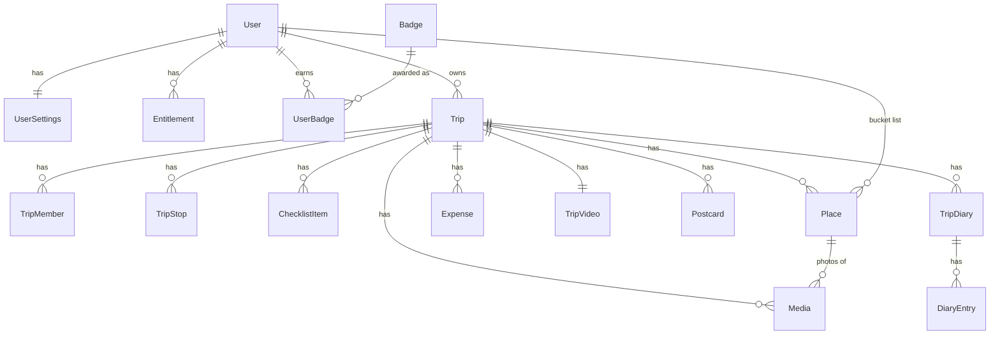

# Egli data model

Version 0.2, 9 Nov 2026. This file is the source of truth for the data model. It replaces section 8 of the handoff document.

Labels:
- **AGREED**: confirmed by the owner. Do not change without a new decision.
- **PROPOSED**: written by Claude, waiting for the owner. Each one has a recommendation.
- **OPEN**: a choice is needed. See "Decisions needed" below.

---

## Decisions needed

Answer these and the PROPOSED entities become AGREED. Each line gives Claude's recommendation first.

| # | Question | Recommendation | Alternative |
| --- | --- | --- | --- |
| D1 | Place: one entity for bucket list, planned and visited? | Yes, one record moves through its life | Three separate entities |
| D2 | Removed member: what happens to their pins and photos? | Others keep the originals. The removed person gets personal copies | Their content disappears for everyone |
| D3 | Who owns a photo in a shared trip? | The person who added it | The trip owner |
| D4 | Photo upload: when can others see a shared photo? | Record syncs first, others see a grey placeholder until the file is uploaded | Record syncs only after the file is uploaded |
| D5 | Shared trip expenses: which currency are totals in? | The trip's home currency (the owner's). Each expense keeps its original amount too | Each member sees their own home currency (needs a daily rate table on the server) |
| D6 | Expense splitting in V1 | "Paid by" plus an equal split between chosen members, with a "who owes whom" summary | No splitting in V1, only "paid by" |
| D7 | Personal expenses in a shared trip (only you see them)? | Yes, same `scope` field as places | All expenses in a shared trip are shared |
| D8 | Who fills in the exchange rate when the expense was added offline? | The server, during sync, using the expense date | The phone, when it is back online |
| D9 | Postcards: one per country or per trip? | One per country per trip (a trip to Italy and France gives 2) | One per trip, or one per country for life |
| D10 | Diary: what does it contain? | One entry per day (AI text the user can edit, with photos and places), plus a short trip summary | One block of text for the whole trip |
| D11 | Diary in a shared trip | Each member gets their own diary | One diary for the whole group |
| D12 | Who awards badges? | The server, during sync (the phone shows the celebration after sync) | The phone, offline |
| D13 | Does joining someone's shared trip use up your free trip? | No, only trips you own count | Yes, every trip counts |
| D14 | Does a deleted trip still count toward the free limit? | Yes, after 24 hours (stops create-and-delete abuse) | No, deleted trips never count |
| D15 | Offline grace for paid plans | Paid features keep working offline for 7 days after the last check (set in the back office) | Always trust the cached plan until it expires |
| D16 | Videos from the photo library (not only photos) in V1? | No, photos only in V1 | Yes |

---

## 1. Rules for every entity (AGREED)

- IDs are created on the phone (UUID v7). Exception: `User.id` is created by the server.
- Sync fields on every synced record: `createdAt`, `updatedAt`, `deletedAt` (soft delete), `version`.
- Sync pushes changed records from the outbox and pulls everything changed since the last cursor.
- Conflicts are resolved per field, last change wins.
- Derived data is not stored: visited countries, lifetime stats, the globe and the library screen are computed.

New rules (PROPOSED):
- Money is stored in minor units as whole numbers (`1250` = 12.50 EUR, `1500` = 1500 JPY). This avoids rounding errors. The number of decimals comes from the Currency table.
- Fields marked **local** live only on the phone and are never synced.
- Fields marked **server** can only be set by the server. The phone sends them back unchanged or not at all.
- Files (photos, videos, postcards) are stored in Azure Blob Storage. Records hold a `key`, never a full URL. The app asks the server for a short-lived URL when it needs the file.

## 2. Overview

---

## 3. User (AGREED)

| Field | Type | Required | Notes |
| --- | --- | --- | --- |
| `id` | UUID | yes | server |
| `email` | string | yes | Unique. server |
| `emailVerified` | boolean | yes | server |
| `authProvider` | enum: google, apple, email | yes | server |
| `firstName` | string | yes | Max 60 |
| `lastName` | string | no | Asked only when needed (album order or payment) |
| `displayName` | string | no | Defaults to first name |
| `avatarMediaId` | UUID | no | |
| `passportCountry` | ISO 3166-1 alpha-2 | yes | Issuing country |
| `residenceCountry` | ISO 3166-1 alpha-2 | yes | |
| `homeCurrency` | ISO 4217 | yes | Defaults from residence |
| `language` | string | yes | `en` |
| `timeZone` | IANA | yes | For reminders |
| `ageConfirmedAt` | timestamp | yes | "I am 16 or older". No age or birth date stored. server |
| `termsVersion`, `termsAcceptedAt` | string, timestamp | yes | server |
| `privacyVersion`, `privacyAcceptedAt` | string, timestamp | yes | server |
| `marketingConsent`, `marketingConsentAt` | boolean, timestamp | no | Off by default |
| `onboardingCompletedAt` | timestamp | no | |
| `status` | enum: active, deletion_requested | yes | server |
| sync fields | | yes | |

## 4. UserSettings (AGREED, synced, one per account)

| Field | Default |
| --- | --- |
| `remindersEnabled` | true |
| `remindChecklist` | true |
| `remindPackTonight` | true |
| `remindFlight` | true |
| `remindAnniversary` | true |
| `reminderTime` | 19:00 local |
| `quietHoursStart`, `quietHoursEnd` | 22:00, 08:00 |
| `distanceUnit` | km (or mi) |
| `temperatureUnit` | C (or F) |
| `defaultPlaceScope` | shared (or personal) |

## 5. DeviceSettings (AGREED, local only)

`uploadOnWifiOnly` (true), `theme` (system, light, night), `autoCaptureEnabled` (false), `autoCaptureCursor`, `pushPermission`, `analyticsConsent`, `lastSyncCursor`, `lastSyncAt`.

## 6. AppConfig (AGREED, read-only, set in the back office, cached for offline)

`photoQualityByPlan`, `maxPhotoSizeMB`, `minAppVersion`, feature flags (for example `printAlbumEnabled`), `freeTripLimit`.

PROPOSED additions: `offlineGraceDays` (7, see D15), `staticDataVersion` and `staticDataUrl` (to update countries and currencies without an app release).

## 7. Trip (AGREED)

| Field | Type | Required | Notes |
| --- | --- | --- | --- |
| `id` | UUID | yes | |
| `ownerId` | UUID | yes | |
| `name` | string | yes | Defaults from the stops |
| `type` | enum: solo, shared | yes | Can switch from solo to shared |
| `startDate`, `endDate` | date | no | Empty when unknown (countdown and reminders stay off) |
| `flightOutAt`, `flightBackAt` | datetime | no | |
| `activities` | list of enums | no | Beach, City, Culture, Food, Hiking, Skiing, Road trip, Business, Relaxing |
| `status` | enum: planned, finished | yes | Active is derived from the dates |
| `finishedAt` | timestamp | no | Set by "Finish trip" |
| `coverMediaId` | UUID | no | |
| `passportCountrySnapshot` | ISO country | yes | Copied from the user at creation |
| `homeCurrencySnapshot` | ISO currency | yes | Also the currency of shared expense totals (D5) |
| `checklistGeneratedAt`, `checklistRulesVersion` | timestamp, string | no | |
| `anniversaryEnabled` | boolean | yes | Default true |
| sync fields | | yes | |

Finishing a trip: the app asks "How was <trip>?" the day after the end date. The user can finish it earlier by hand.

## 8. TripStop (AGREED)

`id`, `tripId`, `order`, `countryCode`, `cityName`, `lat`, `lng`, `geoProviderId`, `nights`, sync fields. Arrival and departure dates are calculated from the trip start date and the nights in order.

## 9. TripMember (AGREED)

`id`, `tripId`, `userId` (empty until the invite is accepted), `inviteToken` (server), `role` (owner, member), `status` (invited, active, left, removed), `invitedAt`, `joinedAt`, `removedAt`, sync fields. Only the owner invites or removes. V1 travelers exist only as accounts.

## 10. ChecklistItem (AGREED)

| Field | Type | Notes |
| --- | --- | --- |
| `id`, `tripId` | UUID | |
| `type` | enum: task, packing | |
| `title`, `notes` | string | |
| `category` | enum | Tasks: documents, money, health, phone, transport, stay, other. Packing: clothes, toiletries, tech, documents, other |
| `done` | boolean | Done or packed |
| `doneAt`, `doneByUserId` | timestamp, UUID | |
| `dueDate` | date | Auto items derive it from a rule |
| `quantity` | number | Packing only |
| `reason` | enum: rule, weather, activity, user | |
| `source` | enum: auto, user | |
| `ruleId` | string | Stops the same auto item coming back |
| `sourceUrl`, `sourceCheckedAt` | string, date | Entry-rule items, with the "verify with official sources" disclaimer |
| `ownerUserId` | UUID | Only for personal packing items |
| `sortOrder` | number | |
| sync fields | | |

Rules: in shared trips, tasks are shared and packing items are personal. When dates, stops or activities change: new items are added; auto items no longer relevant and not done are removed with undo; items the user added, edited or ticked are never removed; a deleted auto item stays deleted.

---

## 11. Place (PROPOSED, needs D1 and D2)

Pins, planned places and bucket-list items in one entity.

| Field | Type | Required | Notes |
| --- | --- | --- | --- |
| `id` | UUID | yes | |
| `tripId` | UUID | no | Empty only for bucket-list items |
| `createdByUserId` | UUID | yes | |
| `ownerUserId` | UUID | no | Set only when `scope` is personal |
| `scope` | enum: shared, personal | yes | Bucket-list items are always personal. Default from `UserSettings.defaultPlaceScope` |
| `status` | enum: bucket, planned, visited | yes | Pin shape: bucket dotted, planned outlined, visited filled |
| `title` | string | yes | Max 120 |
| `note` | string | no | The user's own text |
| `lat`, `lng` | number | yes | |
| `countryCode` | ISO country | yes | Used for the globe and passport stamps |
| `cityName`, `address`, `geoProviderId` | string | no | |
| `category` | enum: food, sight, stay, transport, other | yes | Default other |
| `plannedDate` | date | no | |
| `visitedAt` | datetime | no | Set when marked visited |
| `source` | enum: manual, autocapture | yes | |
| `isSuggested` | boolean | yes | True while auto-capture waits for the user. Suggested places are never shared |
| `coverMediaId` | UUID | no | |
| `copiedFromPlaceId` | UUID | no | Set on personal copies made when a member is removed (D2) |
| sync fields | | yes | |

Rules:
- One record goes through its life: bucket, then planned (when added to a trip, `tripId` is set), then visited.
- Marking visited is manual in V1. Auto-capture only suggests.
- Adding a bucket item to a shared trip sets `scope` to the user's default.
- A visited place cannot go back to bucket. It can go back to planned.

## 12. Media (PROPOSED, needs D3, D4, D16)

Photos. Also used for avatars.

| Field | Type | Required | Notes |
| --- | --- | --- | --- |
| `id` | UUID | yes | |
| `ownerUserId` | UUID | yes | The person who added it (D3) |
| `tripId` | UUID | no | Empty for an avatar |
| `placeId` | UUID | no | A photo belongs to at most one place |
| `purpose` | enum: trip_photo, avatar | yes | |
| `scope` | enum: shared, personal | yes | Same meaning as Place |
| `source` | enum: camera, library, autocapture | yes | |
| `isSuggested` | boolean | yes | True while auto-capture waits for the user |
| `caption` | string | no | |
| `takenAt` | datetime | no | From the photo, with its time zone offset |
| `lat`, `lng`, `countryCode` | number, string | no | From the photo |
| `width`, `height` | number | yes | |
| `mimeType` | string | yes | image/jpeg or image/heic |
| `contentHash` | string | yes | Stops the same photo being added twice |
| `qualityTier` | enum: compressed, full | yes | Decided by AppConfig and the plan when uploaded |
| `fileKey`, `thumbnailKey` | string | no | server. Empty until uploaded |
| `sizeBytes` | number | no | server |
| `uploadedAt` | timestamp | no | server. Empty means "not uploaded yet" (placeholder for others, D4) |
| `includeInVideo` | boolean | yes | Default true |
| `sortOrder` | number | no | |
| sync fields | | yes | |

Local only (table `MediaLocal`, one row per Media on this phone): `mediaId`, `localUri`, `deviceAssetId` (photo library id), `uploadStatus` (pending, uploading, uploaded, failed), `uploadAttempts`, `lastError`.

Upload flow:
1. The phone saves the photo and the Media record locally.
2. The record syncs like any other record.
3. A background job asks the server for an upload URL, uploads the file (Wi-Fi only by default), then tells the server it is done. The server sets `fileKey`, `thumbnailKey`, `sizeBytes`, `uploadedAt`.
4. A new phone downloads thumbnails first and full files when they are opened.

Notes:
- If a free user later upgrades, photos already uploaded stay compressed unless the original is still on the phone. The app can offer "upload originals" for those.
- Deleted photos: soft delete now, files removed from storage after 30 days.

## 13. Expense (PROPOSED, needs D5 to D8)

| Field | Type | Required | Notes |
| --- | --- | --- | --- |
| `id` | UUID | yes | |
| `tripId` | UUID | yes | |
| `createdByUserId` | UUID | yes | |
| `paidByUserId` | UUID | yes | Defaults to the creator |
| `scope` | enum: shared, personal | yes | Personal expenses are seen only by `ownerUserId` (D7) |
| `ownerUserId` | UUID | no | Set only when personal |
| `title` | string | yes | Max 80 |
| `category` | enum: food, transport, stay, activities, shopping, other | yes | |
| `amountMinor` | integer | yes | In `currency` |
| `currency` | ISO currency | yes | Defaults to the local currency of the current stop |
| `spentAt` | datetime | yes | Defaults to now |
| `fxRate` | decimal | no | server. From `currency` to `homeCurrency`. Never changes once set |
| `fxRateDate` | date | no | server |
| `homeCurrency` | ISO currency | yes | Copied from `Trip.homeCurrencySnapshot` |
| `homeAmountMinor` | integer | no | server. `amountMinor × fxRate`, rounded |
| `splitUserIds` | list of UUID | no | Shared only. Equal split between these members (D6) |
| `placeId` | UUID | no | |
| `note` | string | no | |
| sync fields | | yes | |

Rules:
- Offline expenses are saved without a rate. The home amount shows "converting…" until sync, when the server fills the rate for `spentAt` (D8).
- If the amount or currency is edited, the server sets a new rate. Editing only the title keeps the rate.
- "Who owes whom" is computed, not stored.

## 14. TripVideo (AGREED structure, one per trip)

`id`, `tripId` (unique), `userId`, `templateId`, `musicTrackId`, `aspectRatio` (9:16 default, 1:1, 16:9), `durationSec`, `status` (queued, rendering, ready, failed), `fileKey`, `thumbnailKey`, `sizeBytes`, `inputsHash`, `renderedAt`, sync fields.

Generated when the trip is finished, or at the anniversary if skipped. A new version replaces the old file only once ready. Offline, it stays queued. The anniversary notification opens the saved video. Where it is rendered (phone or server) is still open.

## 15. Postcard (PROPOSED, needs D9)

One per country per trip, per user.

| Field | Type | Required | Notes |
| --- | --- | --- | --- |
| `id` | UUID | yes | |
| `userId` | UUID | yes | |
| `tripId` | UUID | yes | |
| `countryCode` | ISO country | yes | Unique together with `userId` and `tripId` |
| `style` | enum: ai, classic | yes | Classic is the one manually designed style |
| `message` | string | no | Text on the back, editable |
| `sourceMediaIds` | list of UUID | no | Photos used to make it |
| `status` | enum: queued, generating, ready, failed | yes | |
| `imageKey`, `thumbnailKey` | string | no | server |
| `inputsHash` | string | no | To offer "make a new one" when the trip changes |
| `generatedAt` | timestamp | no | server |
| sync fields | | yes | |

## 16. TripDiary and DiaryEntry (PROPOSED, needs D10 and D11)

**TripDiary**, one per trip per user.

| Field | Type | Required | Notes |
| --- | --- | --- | --- |
| `id` | UUID | yes | |
| `tripId`, `userId` | UUID | yes | Unique together |
| `summary` | string | no | Short AI summary of the trip, editable |
| `status` | enum: queued, generating, ready, failed | yes | |
| `inputsHash` | string | no | |
| `generatedAt` | timestamp | no | server |
| sync fields | | yes | |

**DiaryEntry**, one per day.

| Field | Type | Required | Notes |
| --- | --- | --- | --- |
| `id` | UUID | yes | |
| `diaryId` | UUID | yes | |
| `day` | date | yes | |
| `title` | string | no | |
| `body` | string | yes | AI text, then the user's edits |
| `mediaIds`, `placeIds` | list of UUID | no | |
| `source` | enum: ai, user | yes | |
| `editedByUserAt` | timestamp | no | Once set, regenerating never overwrites this entry |
| `sortOrder` | number | yes | |
| sync fields | | yes | |

## 17. Badge and UserBadge (PROPOSED, needs D12)

**Badge** is a read-only catalog, defined in the back office, cached on the phone.

`code` (string, primary key, for example `first_trip`), `title`, `description`, `iconKey`, `category` (trips, countries, continents, memories, special), `sortOrder`, `active`, `rule` (server only, JSON, for example "visited 10 countries").

**UserBadge**: `id`, `userId`, `badgeCode`, `earnedAt`, `tripId` (the trip that earned it, optional), `seenAt` (set by the phone after the celebration), sync fields. Created by the server only (D12). Unique per `userId` and `badgeCode`.

## 18. Country and Currency (PROPOSED, static data shipped with the app)

Not synced. Shipped as JSON in the app, updated by `AppConfig.staticDataVersion`.

**Country**: `code` (ISO alpha-2), `name`, `flag` (emoji), `continent`, `currencyCode`, `centroidLat`, `centroidLng`, `isSchengen`, `isEU`. Country shapes for the globe are a separate asset.

**Currency**: `code` (ISO 4217), `name`, `symbol`, `minorUnits` (2 for EUR, 0 for JPY).

## 19. Entitlement (PROPOSED, needs D13 to D15)

The user's plan and purchases. Server only; the phone reads it and caches it.

| Field | Type | Required | Notes |
| --- | --- | --- | --- |
| `id` | UUID | yes | |
| `userId` | UUID | yes | |
| `kind` | enum: trip_pass, yearly_pass, subscription, promo | yes | Free is "no active entitlement" |
| `tripId` | UUID | no | Only for `trip_pass` |
| `store` | enum: apple, google, web, manual | yes | Manual = given in the back office |
| `productId` | string | yes | Store product id |
| `originalTransactionId` | string | no | For store receipts |
| `status` | enum: active, grace, expired, refunded, revoked | yes | |
| `startsAt`, `expiresAt` | timestamp | yes, no | No expiry for a trip pass |
| `lastVerifiedAt` | timestamp | yes | Last check with the store |
| sync fields | | yes | |

How the app checks it:
- Free trips: count trips the user owns (D13), including those deleted more than 24 hours ago (D14). Compare with `AppConfig.freeTripLimit`.
- Paid: any `active` or `grace` entitlement whose `expiresAt` is in the future.
- Offline: trust the cached entitlement for `offlineGraceDays` after `lastVerifiedAt` (D15). Nothing already created is ever locked; only new paid actions are blocked.

Pricing itself is still open (handoff section 9, item 7). This shape works for per-trip, yearly pass and subscription.

---

## 20. Not in this version

- **AlbumOrder** (printed albums, shipping, payment with the local processor): define with the print-on-demand decision.
- **Companions without the app**: later release.
- **Offline map regions**: later paid feature.
- **Local notifications**: scheduled on the phone from Trip and UserSettings. Nothing is stored on the server.
